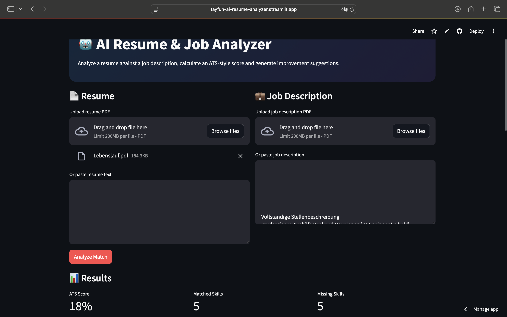

# 🤖 AI Resume & Job Analyzer

AI-powered resume and job matching application built with **Python**, **Streamlit**, **SQLite**, **Plotly** and optional **OpenAI integration**.

🔗 **Live Demo:** Coming soon



## ✨ Features

- Upload a resume PDF
- Upload or paste a job description
- Extract text from PDF files
- Calculate an ATS-style match score
- Visualize the score with an interactive Plotly gauge
- Detect matched skills
- Detect missing skills
- Generate resume improvement suggestions
- Generate a cover letter draft
- Store analyses locally with SQLite
- Export report as Markdown
- Export report as PDF
- Docker support
- Automated tests with GitHub Actions
- Ready for Streamlit Cloud deployment

## 🛠️ Tech Stack

- Python
- Streamlit
- PyPDF2
- SQLite
- Plotly
- ReportLab
- OpenAI API
- Pytest
- Docker
- GitHub Actions

## 📂 Project Structure

```text
src/
├── database.py
├── exporter.py
├── openai_service.py
├── pdf_export.py
├── pdf_reader.py
├── scoring.py
├── skills.py
└── text_processing.py
```

## ⚙️ Installation

```bash
git clone https://github.com/tayfun-dlouhy/ai-resume-job-analyzer.git
cd ai-resume-job-analyzer
python3 -m venv venv
source venv/bin/activate
pip install -r requirements.txt
python -m streamlit run app.py
```

## 💻 Usage

1. Upload a resume as PDF.
2. Upload or paste a job description.
3. Click **Analyze Match**.
4. Review ATS score, matched skills, missing skills and suggestions.
5. Export the result as Markdown or PDF.

## 🎯 Skills Demonstrated

- Python application development
- PDF text extraction
- NLP-style keyword matching
- ATS-style scoring
- Data persistence with SQLite
- Data visualization with Plotly
- PDF report generation
- Streamlit UI development
- Docker basics
- GitHub Actions basics
- Cloud deployment preparation

## 🔮 Future Improvements

- Add real vector embeddings
- Add user authentication
- Add persistent cloud database
- Add recruiter dashboard
- Add multiple resume comparison
- Improve cover letter generation with job-specific prompts
- Add PDF resume optimization export

## 👨‍💻 Author

**Tayfun Dlouhy**

GitHub: https://github.com/tayfun-dlouhy

## 📄 License

MIT License